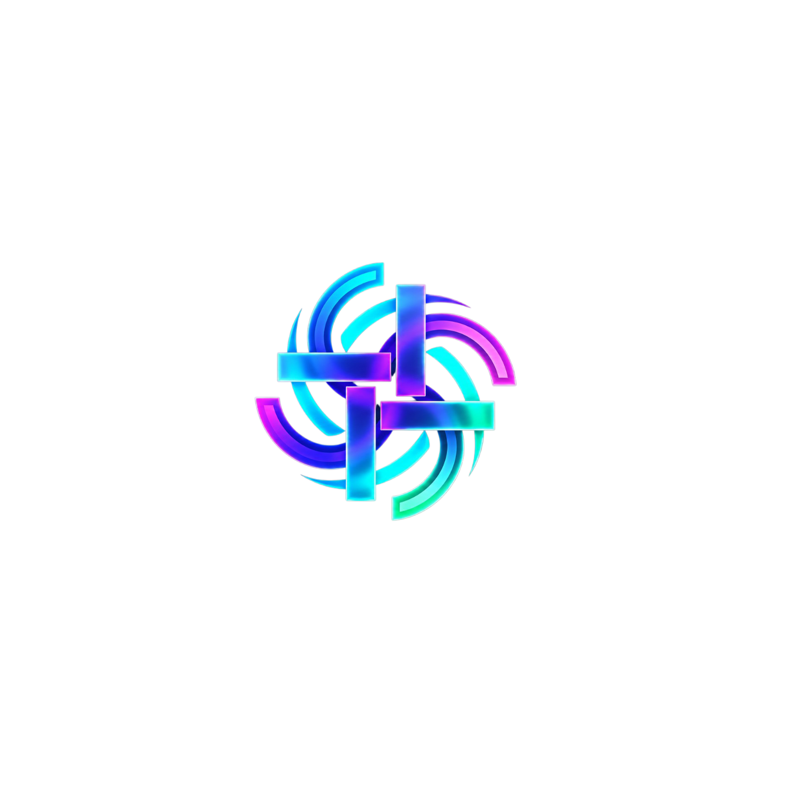
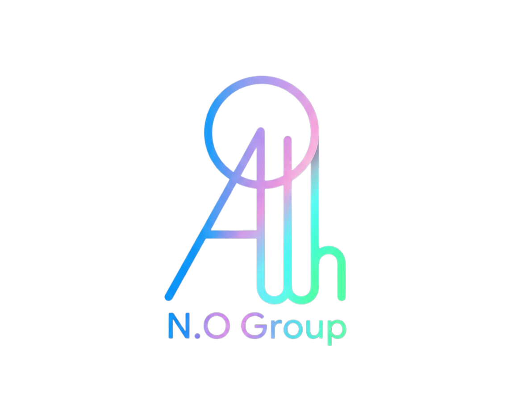

<p align="center">
  
</p>

<h1 align="center">Vortex · Multi-Cloud Storage Engine</h1>

<p align="center">
  <b>N.O Group</b> · <a href="https://no-group.org">no-group.org</a><br/>
  High-performance Backend-as-a-Service and real-time infrastructure.
</p>

---

This monorepo contains the **Vortex Storage Engine** and its **Dashboard Management
Interface**: a fully typed, production-ready TypeScript implementation of a unified
S3-compatible object-storage layer across six cloud targets, with a Cloudinary-style
media pipeline, cryptographically signed webhooks, row-level security, and an
AMOLED-native React console built on the official N.O Group design system.

## Monorepo layout

```
N.O-Group/
├── apps/
│   ├── vortex-server/        # Vortex Storage Engine (Express + multi-driver core)
│   │   └── src/
│   │       ├── core/types/storage.types.ts    # IVortexStorageDriver contract
│   │       ├── core/drivers/                  # 6 provider adapters
│   │       ├── core/factory/driver.registry.ts
│   │       ├── guards/vortex-storage.guard.ts # RLS JWT guard
│   │       ├── media/transform.service.ts     # edge image transforms (sharp)
│   │       ├── services/multipart-janitor.ts  # 24h orphan cleanup
│   │       ├── webhooks/webhook.service.ts    # HMAC-SHA256 + backoff
│   │       └── routes/storage.routes.ts       # REST surface
│   └── vortex-dashboard/      # React 18 + Vite console (N.O Group design system)
│       └── src/
│           ├── styles/tokens.css              # official AMOLED + 6-stop tokens
│           ├── components/MultiCloudSelector.tsx
│           └── pages/                         # Overview · Storage · Media · Webhooks · Settings
├── vortex_data/               # runtime volume (git-ignored): objects, cache, registry
└── package.json               # npm workspaces
```

## Storage targets

| Driver ID | Role | Endpoint | Notes |
|---|---|---|---|
| `cloudflare_r2` | **Default managed cloud** | `https://<account_id>.r2.cloudflarestorage.com` | $0 egress/bandwidth |
| `aws_s3` | Enterprise compliance | `https://s3.<region>.amazonaws.com` | Dynamic region parsing, snapshot retention |
| `digitalocean_spaces` | Indie / staging | `https://<region>.digitaloceanspaces.com` | Flat bandwidth allowance |
| `gcs` | AI/ML & analytics | `https://storage.googleapis.com` | S3 Interoperability XML API (HMAC keys) |
| `azure_blob` | Corporate IT / B2B | `https://<account>.blob.core.windows.net` | Native Block Blob + SAS presigns |
| `local_disk` | Dev / Docker single-node | `./vortex_data/storage/` | Zero-cost persistent volume |

## Quickstart

```bash
npm install
npm run dev:server      # engine → http://127.0.0.1:8787
npm run dev:dashboard   # console → http://127.0.0.1:5173 (/api proxied to the engine)
npm run seed            # optional demo objects (avatars, gradient art, multipart sample)
```

The engine boots with `local_disk` active and dev-auth bypass enabled. Configure any
cloud block in `apps/vortex-server/.env` (see `.env.example`) and switch the runtime
engine live from the dashboard's **Multi-Cloud Selector** — no restarts.

## API surface (v1)

| Endpoint | Purpose |
|---|---|
| `POST /v1/storage/presigned-upload` | Time-limited signed URLs (default 15 min) for direct browser→cloud transfers |
| `POST /v1/storage/multipart/initiate` · `PUT …/upload-part` · `POST …/complete` | Chunked multipart ingest (orphans auto-aborted after 24h) |
| `POST /v1/storage/bulk-delete` | Purge up to 1,000 keys with parallel fallback |
| `GET /v1/storage/render?path&w&h&fmt&q&fit` | On-the-fly WebP/AVIF transform + immutable rendition cache |
| `GET /v1/storage/objects` · `GET/DELETE /v1/storage/object?key=` | Enumerate / download / delete |
| `GET /v1/storage/providers` · `POST …/providers/active` | Multi-cloud control plane |
| `GET /v1/storage/webhooks/feed` | Signed event + delivery ledger |
| `GET /health` · `GET /v1/system/info` | Ops |

## Security model

- **Row-Level Access Security** — the `VortexStorageGuard` verifies HS256 JWTs and
  binds claims to object paths (`buckets/user-avatars/{user_id}/*` ⟹ `jwt.sub == user_id`).
  Admin-key requests authenticate as the service identity.
- **Signed webhooks** — every delivery carries
  `X-Vortex-Signature: t=<ts>,v1=HMAC_SHA256(secret, "<ts>.<body>")` and retries with
  exponential backoff; terminal failures dead-letter to disk.
- **Presign TTL ceiling** 1h; object keys are traversal-sanitized in every driver.

## N.O Group design system

The console renders on pure AMOLED black with the official 6-stop spectrum palette:

| Token | Hex | Name |
|---|---|---|
| `--vtx-canvas` | `#000000` | Canvas background (all layers) |
| `--vtx-surface` | `#090C10` | Elevated card surface |
| `--vtx-border` | `#161B22` | Structural borders & dividers |
| `--vtx-stop-1` | `#004BFF` | Anchor Blue |
| `--vtx-stop-2` | `#A38CFF` | Iridescent Lavender |
| `--vtx-stop-3` | `#FFA1C5` | Coral Pink |
| `--vtx-stop-4` | `#00D2FF` | Cyber Cyan |
| `--vtx-stop-5` | `#00E6A6` | Neon Mint |
| `--vtx-stop-6` | `#1BFF6B` | Flagship Tech Green |

Active selections wear the animated spectrum ring (`GradientBorder`) over glassmorphic
surfaces. Tokens live in `apps/vortex-dashboard/src/styles/tokens.css` — nothing else
in the console hardcodes a hex value.

---

<p align="center">
  <br/>
  © N.O Group — all proprietary infrastructure. See <code>no-group.org_ownership_letter.pdf</code>.
</p>
